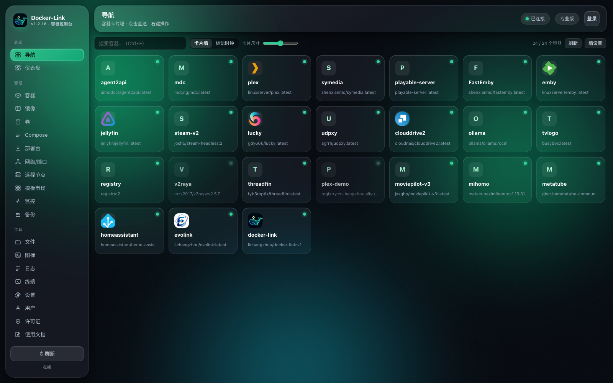
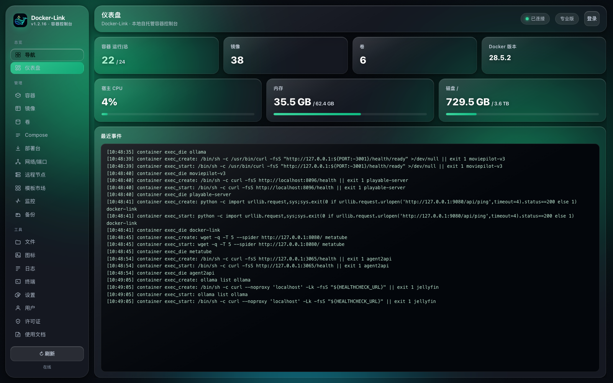
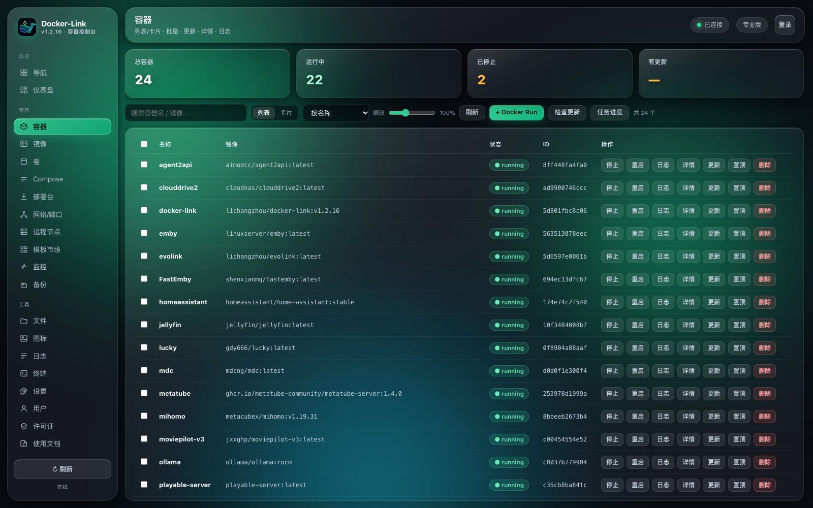
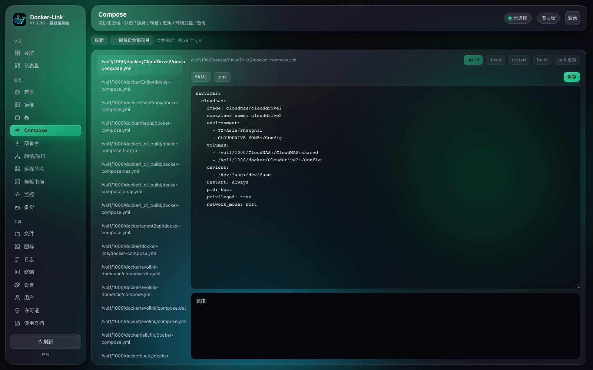
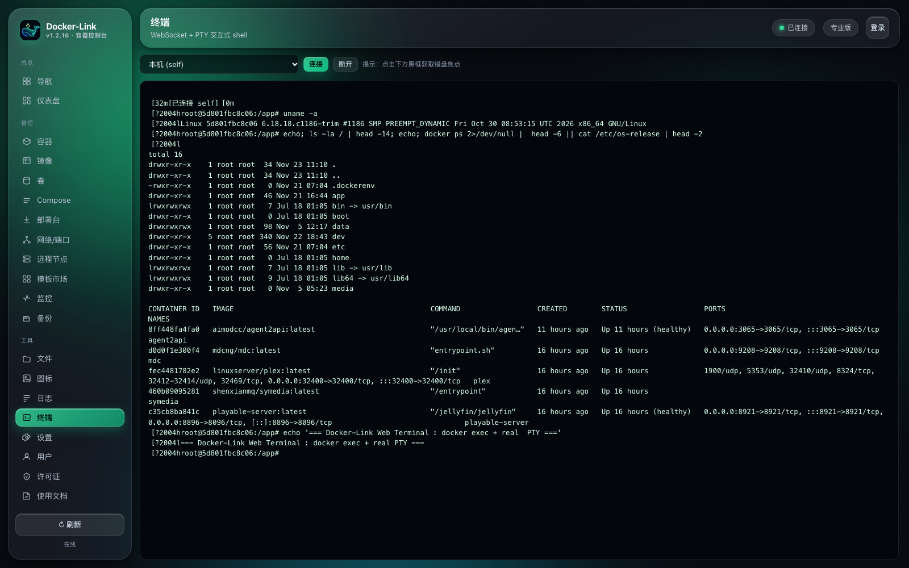
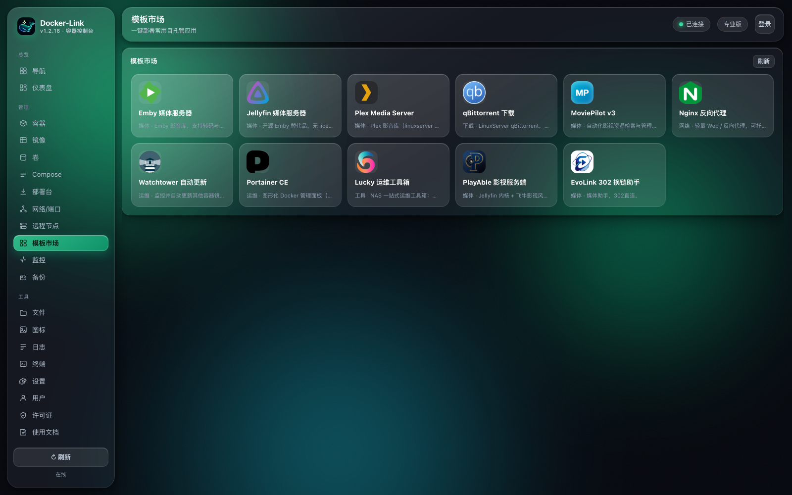
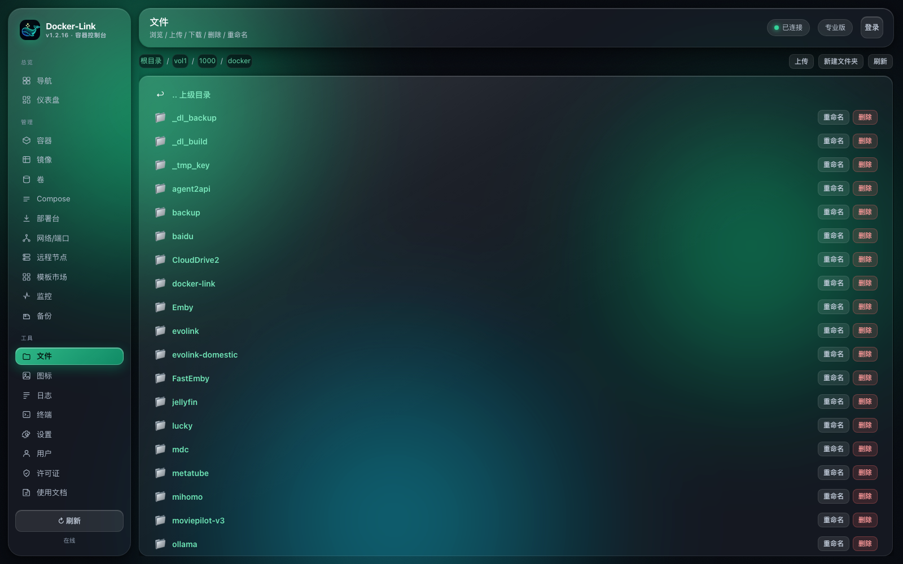
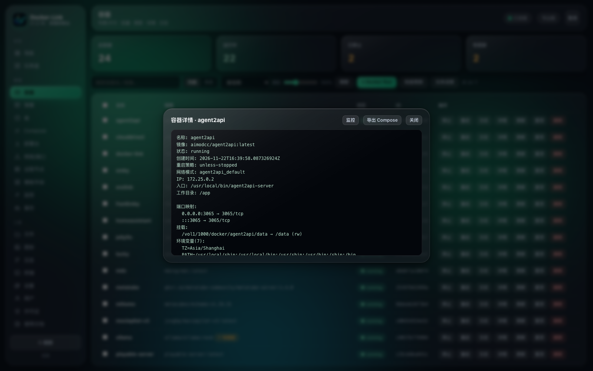
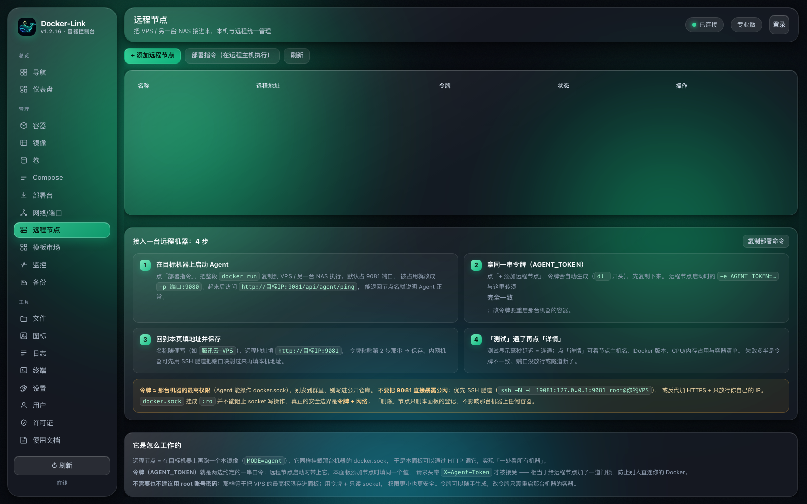

<div align="center">

# 🐳 Docker-Link

**单容器部署的 Docker 可视化管理面板 —— 完整复刻 Dockter 全部功能**

[](https://hub.docker.com/r/lichangzhou/docker-link)
[](https://hub.docker.com/r/lichangzhou/docker-link)
[](https://github.com/lichangzhou/Docker-link)
[](https://github.com/lichangzhou/Docker-link)
[](LICENSE)
[](https://hub.docker.com/r/lichangzhou/docker-link)

**中文** | [English](#english)

</div>

---

## 📸 界面预览

> 深色玻璃拟态（Liquid Glass）界面，主色 **绿色 `#34d399`**，风格借鉴自 [EvoLink](https://github.com/lichangzhou/EvoLink)。
>
> 以下截图均为**真实运行实例**（v1.2.16，NAS 上 24 个容器 / 38 个镜像的实况），非设计稿。完整素材清单见 [`docs/assets/`](docs/assets/)。

| 卡片墙导航 | 仪表盘 | 容器管理 |
|:---:|:---:|:---:|
|  |  |  |
| **Compose 项目**（文件即真相源） | **Web 终端**（真 PTY 交互） | **模板市场**（一键部署） |
|  |  |  |
| **文件管理** | **容器详情** | **远程节点接入** |
|  |  |  |

更多截图：镜像管理 · 卷 · 网络 · 图标库 · 监控与自动恢复 · 备份与跨机迁移 · 部署控制台 · 设置与失效恢复。

---

## ⚡ 一键部署

### Docker Compose（推荐）

```bash
mkdir -p /opt/compose && cd /opt/compose
curl -fsSL https://raw.githubusercontent.com/lichangzhou/Docker-link/main/docs/docker-compose.yml -o docker-compose.yml
docker compose up -d
```

打开 `http://<你的服务器IP>:9080` 即可。

### docker run

```bash
docker run -d \
  --name docker-link \
  --restart always \
  -p 9080:9080 \
  -v /var/run/docker.sock:/var/run/docker.sock:ro \
  -v /opt/compose:/opt/compose:rw \
  -v docker-link-data:/data \
  -v docker-link-config:/app/config \
  -e TZ=Asia/Shanghai \
  lichangzhou/docker-link:latest
```

### 远程节点（Agent 模式）

在目标机跑同一个镜像的 Agent 端，面板通过 `X-Agent-Token` 调用：

```bash
docker run -d --name docker-link-agent --restart always \
  -p 9081:9081 \
  -v /var/run/docker.sock:/var/run/docker.sock:ro \
  -e MODE=agent \
  -e AGENT_NAME=my-node \
  -e AGENT_TOKEN=<你的强随机令牌> \
  lichangzhou/docker-link:latest
```

---

## ✨ 核心功能

| 模块 | 能力 |
|------|------|
| **容器管理** | 启停 / 重启 / 删除 / 详情 / 端口 / 挂载 / 环境变量 / 标签；列表与卡片双视图、置顶、4 种排序、批量操作；CPU / 内存 / 网络实时监控图表 |
| **镜像管理** | 拉取 / 删除 / 导出；**更新检查**（索引 digest 比对）；**一键更新**（加速源 → dockerd 直连 → 容器内代理 `docker load` 三层兜底），失败自动回滚 |
| **卷 / 网络 / 端口** | 卷与网络增删改查、暴露端口管理 |
| **Docker Compose** | 遍历子目录识别项目、读取与编辑配置、导出 YAML、一键启动停止 |
| **文件管理** | 浏览宿主机目录、上传、下载、在线编辑 |
| **Web 终端** | SocketIO + `docker exec` 的实时 PTY 交互终端 |
| **远程节点** | 同镜像 Agent 模式，**HTTP + SSH 双通道**，多主机集中管理；节点详情含延迟 / 引擎版本 / 资源统计 / 容器清单；一键生成部署指令 |
| **通知推送** | 企业微信应用消息（`text` 类型）推送更新与告警 |
| **图标管理** | 在线图标源自动匹配 + 本地上传；自研项目官方图标走专用通道，不依赖公共 CDN |
| **任务中心** | 更新 / 备份 / 批量操作的任务队列与进度可视化 |
| **导航主页** | 容器卡片墙 + 分组 + 背景模糊 + 大字标语时钟 + `Ctrl+F` 搜索 |

---

## 🏗 架构

| 层 | 技术 |
|---|---|
| 后端 | Python 3.12-slim + **FastAPI** + `docker-py` |
| 终端 | SocketIO / WebSocket（PTY，`socket=True`） |
| 前端 | **单文件** `static/index.html`，原生 JS + fetch，**零构建步骤** |
| 部署 | 单容器 + `docker.sock` 只读挂载，端口 `9080` |
| 远程节点 | 同镜像 `MODE=agent` |

**非前后端分离**，clone 下来改一个 HTML 就能换皮，适合自建与二次开发。

---

## ⚙️ 环境变量

| 变量 | 默认值 | 说明 |
|------|--------|------|
| `ADMIN_USER` / `ADMIN_PASSWORD` | `admin` / 空 | 留空 = 不启用认证；设置后全站 Basic 认证 |
| `COMPOSE_DIR` | `/opt/compose` | Compose 项目根目录（须与 bind 挂载一致） |
| `FS_ROOT` / `FS_ROOTS` | `/data` / 空 | 文件管理可浏览根，多个用 `:` 分隔 |
| `HTTP_PROXY` / `HTTPS_PROXY` | 空 | 更新检查与镜像层下载代理 |
| `NO_PROXY` | `localhost,127.0.0.1,::1` | 内网地址务必加入，否则被代理劫持 |
| `MODE` | `panel` | 设为 `agent` 即被管节点 |
| `AGENT_TOKEN` / `AGENT_NAME` | 空 | Agent 模式令牌与节点名 |
| `TZ` | `Asia/Shanghai` | 时区 |

---

## 🔐 安全须知

> ⚠️ **请务必阅读**
>
> - 面板通过 `/var/run/docker.sock` 与 Docker 引擎交互，**持有面板访问权 ≈ 持有宿主 root 权限**（容器可 `--privileged` 逃逸）。
> - `docker.sock` 挂 `:ro` **只限制挂载文件本身的可写性，并不限制通过 socket 发起的操作**。
> - 默认 **不内置认证**，**请勿直接暴露公网**。如需公网访问，请启用 `ADMIN_USER`/`ADMIN_PASSWORD` 或前置 HTTPS 反代。
> - Agent Token 同理属于 **高敏感凭据**，建议仅走 SSH 隧道或 TLS 加密通道。

---

## 🆚 与其他面板对比

| 维度 | **Docker-Link** | Portainer | Dockge | 1Panel |
|------|----------------|-----------|--------|--------|
| 部署形态 | 单容器，零依赖 | 单容器 | 单容器 | 单容器（带数据库） |
| 前端 | 单文件 HTML，**无构建** | React 产物 | Svelte 产物 | Go + Vue |
| 远程节点 | ✅ HTTP + **SSH 双通道** | ✅ | ❌ | ✅ |
| 企业微信告警 | ✅ 内置 | ❌ | ❌ | ❌ |
| 更新检查 | ✅ 三层拉取兜底 | 部分 | ✅ | ✅ |
| Compose | ✅ 文件即真相源 | ✅ | ✅ | ✅ |
| 界面风格 | **绿色玻璃拟态** | 经典蓝 | 极简 | 现代深色 |

---

## 🧩 生态：三个项目一起用

Docker-Link 不是孤立的面板。它是三个自建项目里负责**运维容器**的那一环：

| 项目 | 定位 | 仓库 |
|---|---|---|
| **Docker-Link** | 运维整个栈：容器、镜像、卷、网络、Compose、文件管理、Web 终端、远程节点、监控告警 | 本仓库 |
| **EvoLink** | 治理媒体库：索引 Emby / Plex / Jellyfin / Playable、缺口比对、归档刮削、权重洗板、115 → 302 换链 | [Evolink](https://github.com/lichangzhou/Evolink) · [EvoLink-CN](https://github.com/lichangzhou/EvoLink-CN) |
| **Playable** | 播放端：Android / Windows / iOS，直接播 `.strm` 库，自动跟随 302 跳转 | [Playable](https://github.com/lichangzhou/Playable) |

```
Docker-Link（跑起来） → EvoLink（理清楚） → Playable（看下去）
```

- 用 Docker-Link 的 **Compose 一键部署** 拉起 EvoLink，用 **监控与自动恢复** 盯着它
- EvoLink 产出的 `.strm` 媒体库由 **Playable** 直接播放，302 全程透明
- **Playable** 同时也是 EvoLink 的索引源之一，只在 Playable 上存在的作品不会被算成缺失

三个项目相互引用、各自独立，谁也不会绑架谁。详见
[EvoLink 的生态文档](https://github.com/lichangzhou/Evolink/blob/main/docs/ECOSYSTEM.md)。

---

## 📄 文档

- [📘 推广方案（零预算版）](docs/推广方案.md) —— 全网核实后的平台选型：**什么值得买 / linux.do / 恩山 / NodeSeek / 阮一峰周刊** 等精准渠道、外链合规矩阵、各站发帖红线、0 预算 8 周节奏
- [✍️ 现成推广稿件](docs/posts/) —— 母稿 + 什么值得买 / linux.do / 掘金 / 阮一峰周刊 / Reddit-HN 专用版，可直接复制发布
- [🧩 生态互推片段库](docs/posts/生态互推片段库.md) —— Docker-Link / EvoLink / Playable 三项目互推的 6 段措辞 + 各平台外链计数表
- [🛠️ 贡献指南](CONTRIBUTING.md)
- [📝 部署用 compose 文件](docs/docker-compose.yml)

---

## 🤝 参与贡献

欢迎任何形式的贡献：提 Issue、报 Bug、补文档、传截图、做翻译。

```bash
git clone https://github.com/lichangzhou/Docker-link.git
cd Docker-link
# 修改后提交 PR 即可
```

详见 [CONTRIBUTING.md](CONTRIBUTING.md)。

---

## 📄 License

本项目采用 **MIT License** 开源。

---

<div align="center">

**如果 Docker-Link 对你有帮助，请给个 ⭐ Star！** 这对我们非常重要。

[](https://github.com/lichangzhou/Docker-link/stargazers)
[](https://github.com/lichangzhou/Docker-link/network/members)
[](https://github.com/lichangzhou/Docker-link/watchers)

**[⬆ 返回顶部](#-docker-link)**

</div>

---

<a name="english"></a>

## English

**Docker-Link** is an open-source, single-container Docker dashboard that replicates Dockter's full feature set while adding several unique capabilities. It offers container, image, volume, network, and port management; Docker-Compose browsing and deployment; a built-in file manager; a real-time web terminal (SocketIO); remote Agent mode for multi-host control over both HTTP and SSH; enterprise WeChat text notifications; an auto-matching icon library; and an update checker that pulls images via accelerated proxy → daemon → fallback `docker load`. The UI follows EvoLink's green glass design, runs on FastAPI plus a single-file front-end, mounts the Docker socket read-only, and listens on port 9080. Docker-Link is published on Docker Hub (`lichangzhou/docker-link`) and GitHub, targeting developers, sysadmins, and small-team DevOps who need a lightweight, secure, and extensible visual interface for Docker management.

**Quick start**

```bash
docker run -d --name docker-link --restart always -p 9080:9080 \
  -v /var/run/docker.sock:/var/run/docker.sock:ro \
  -v /opt/compose:/opt/compose:rw \
  -v docker-link-data:/data -v docker-link-config:/app/config \
  lichangzhou/docker-link:latest
```

**Security note**: access to this panel is equivalent to root access on the host. Do not expose it to the public internet without enabling authentication or placing it behind an HTTPS reverse proxy.
